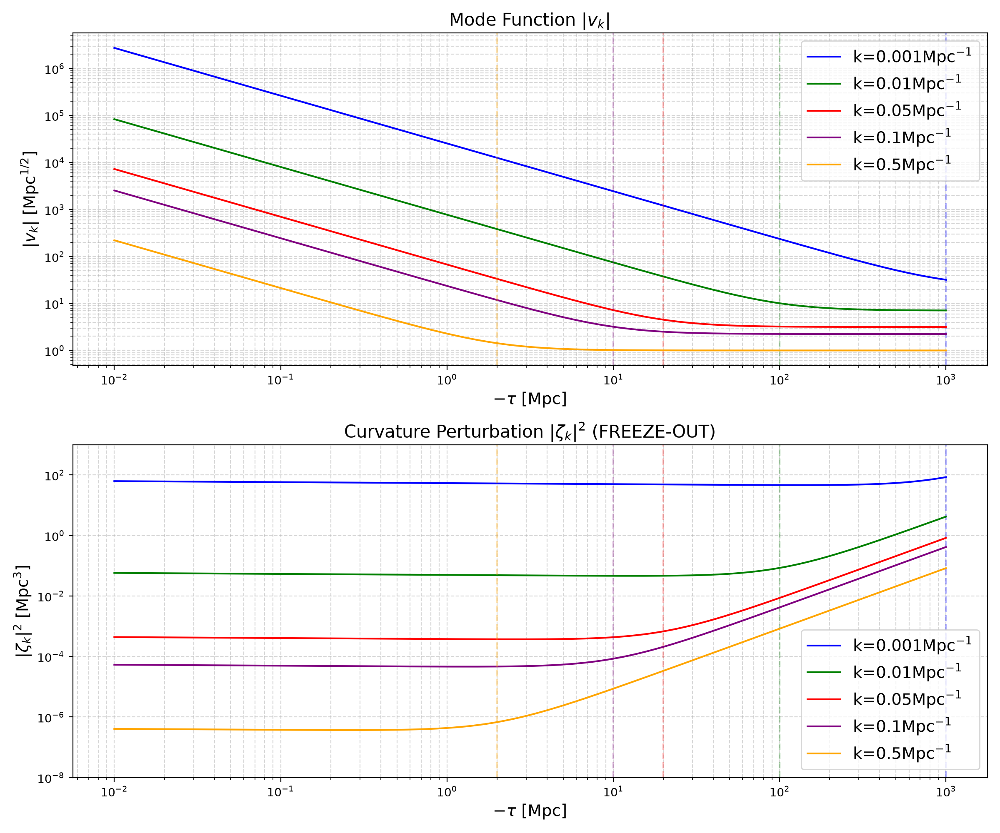
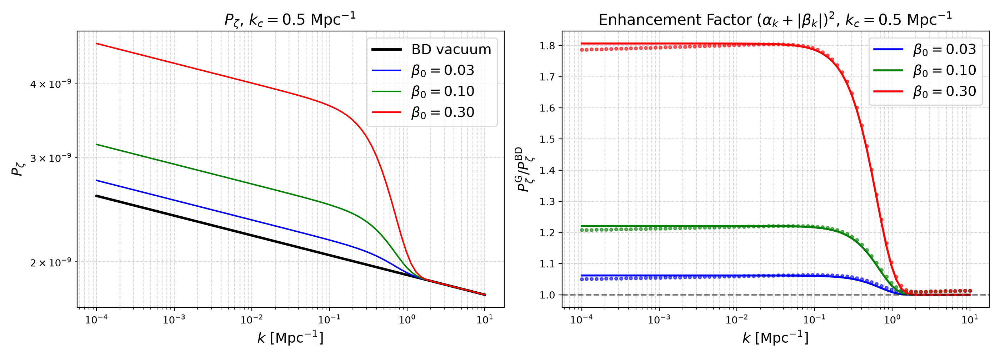
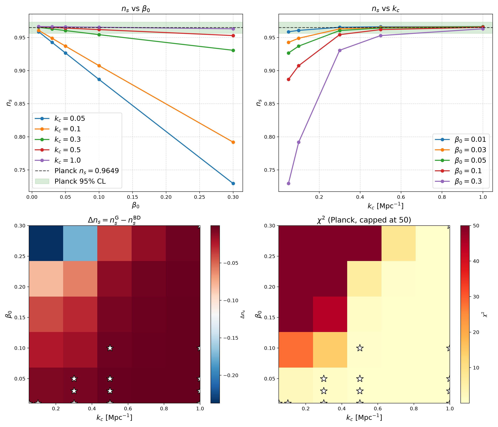

# Gaussian-Cutoff Non-Bunch–Davies Initial States in Quadratic Inflation

This repository contains a complete numerical pipeline to compute the scalar
power spectrum of quadratic inflation, $V(\phi) = \frac{1}{2}m^2\phi^2$, for two
choices of the initial state of the cosmological perturbations:

- **BD state** — the standard Bunch–Davies vacuum, given analytically by Hankel
  functions with index $\nu = \frac{3}{2} + 2\epsilon_{V\star}$;
- **G state** — a Bogoliubov-excited initial state with a Gaussian cutoff,
  $\beta_k = -\beta_0\,e^{-k^2/2k_c^2}$, which modifies the spectrum by the
  enhancement factor $\gamma_k = (\alpha_k + |\beta_k|)^2$ and continuously
  recovers the BD vacuum for $k \ll k_c$ or $\beta_0 \to 0$.

The G-state code integrates the Mukhanov–Sasaki (MS) equation numerically from
deep inside the horizon ($x \equiv -k\tau = 100$) to three e-folds after horizon
exit, using the exact BD mode functions as both benchmark and initial data. A
5×5 parameter scan over $(\beta_0, k_c)$ is compared against the Planck 2018
constraint $n_s = 0.9649 \pm 0.0042$ through a Gaussian $\chi^2$.

## Repository structure

| File | Role |
| --- | --- |
| `BD_state.py` | Analytical BD benchmark: background evolution, exact Hankel mode functions, slow-roll observables ($n_s$, $r$, $\alpha_s$), power spectra and mode-evolution figures. No ODE integration. |
| `G_state.py` | Full numerical pipeline: MS-equation integration with Bogoliubov-transformed initial data, $\mathcal{P}_\zeta(k)$, eight verification tests, 5×5 parameter scan, Planck $\chi^2$ analysis. |

The two files are mirrors of each other: they share the unit convention (Part A),
the physics kernels (Part B) and the code organisation, so the BD benchmark that
the G-state pipeline integrates against is exactly the one documented in
`BD_state.py`.

## Requirements

- Python ≥ 3.8
- `numpy`, `scipy`, `matplotlib`

```bash
pip install numpy scipy matplotlib
```

## Quick start

```bash
python BD_state.py   # analytical benchmark: console report + 3 figures
python G_state.py    # numerical pipeline: tests 1-8, spectra, scan, chi^2
```

The G-state run is dominated by the 5×5 parameter scan and takes a few minutes
on a modern laptop.

## Outputs

### `BD_state.py`

- Console report: derived background quantities ($m_\phi$, $H_\star$), slow-roll
  observables at the pivot and at reference e-folds
- `BD_power_spectra.png` — scalar and tensor power spectra
- `BD_conformal_time.png` — mode functions $|v_k|$, $|\zeta_k|^2$ vs conformal time
- `BD_efolds.png` — the same mode functions vs the e-fold variable $N$
- `BD_console.txt` — the console output

### `G_state.py`

- Console report: verification Tests 1–8, full scan table, Planck-compatible
  parameter summary
- `G_Pzeta.png` — $\mathcal{P}_\zeta(k)$ for the test parameters vs the BD spectrum
- `G_parameter_scan.png` — fitted $n_s$, $\Delta n_s$ heat map and $\chi^2$
  heat map over the $(\beta_0, k_c)$ grid
- `G_tolerance.png` — integrator convergence vs absolute tolerance (Test 1)
- `G_console.txt` — the console output

### Key results


Figure 1: Mode function and curvature perturbation in Bunch-Davies state, with the horizontal axis the **negative** conformal time.


Figure 2: Spectra $\mathcal{P}^{\mathrm{G}}_{\zeta}$ and enhancement factor $\mathcal{P}^{\mathrm{G}}_{\zeta} / \mathcal{P}^{\mathrm{BD}}_{\zeta}$ on spectra in Gaussian-cutoff state.


Figure 3: Parameter scan over $\beta_0$ and $k_c$, together with Planck-based $\chi^2$ varifications.

## Verification tests

Every test only *computes* and returns a `TestResult`; `main()` orchestrates the
report. Throughout, `error` denotes the numerical inaccuracy of the integrator
itself, while `dev` = (numerical − analytical)/analytical is a *physical*
difference between two approximation schemes, not a numerical mistake.

| Test | Content | Type |
| --- | --- | --- |
| 1 | Tolerance convergence at the pivot ($\beta_0 = 0$) | integrator accuracy |
| 2 | Wronskian conservation and normalisation | integrator accuracy |
| 3 | Single mode at the pivot vs the $(\alpha+\|\beta\|)^2$ enhancement | analytical vs numerical |
| 4 | Deviation over the full $k$ range | analytical vs numerical |
| 5 | $\beta_0 \to 0$ limit (G $\to$ BD) | analytical vs numerical |
| 6 | Constant-$\nu$ experiment: identifies the slow-roll drift of $\nu$ as the sole origin of the dev | analytical vs numerical |
| 7 | Freeze-out truncation exclusion (amplitude / phase / $k$-independence) | analytical vs numerical |
| 8 | Closed-form estimate of the dev, compared against Test 6 | analytical vs numerical |

**Numerical accuracy note.** The mode amplitude is tiny in Planck units,
$|v| \sim k^{-1/2} \sim 10^{-11}$, so an insufficient absolute tolerance would
silently take over the error control and limit the effective relative accuracy.
We use `rtol = 1e-13`, `atol = 1e-22`; convergence is verified explicitly in
Test 1.

## Configuration

All user-facing parameters live in Part A of each file:

| Parameter | Default | Meaning |
| --- | --- | --- |
| `N_star` | 60 | e-fold label of the pivot horizon crossing |
| `N_end` | 120 | e-fold label of the end of inflation ($N_\mathrm{end} = 2N_\star$) |
| `k_pivot` | 0.05 | pivot scale in Mpc$^{-1}$ (enters only via $\kappa = k/k_\star$) |
| `A_s_Planck` | 2.1e-9 | scalar amplitude, fixes $m_\phi$ a posteriori |
| `RTOL` / `ATOL` | 1e-13 / 1e-22 | integration tolerances (see accuracy note) |
| `beta_0` | 0.10 | Bogoliubov amplitude of the G state |
| `k_c` | 0.50 | Gaussian cutoff scale in Mpc$^{-1}$ |
| `beta_0s`, `k_cs` | 5×5 grid | scan ranges |
| `ns_planck`, `sigma_ns` | 0.9649, 0.0042 | Planck 2018 central value and 1σ error |

Units: all internal background quantities are in Planck units ($M_\mathrm{pl}=1$);
wavenumbers enter only through the dimensionless ratio $\kappa = k/k_\star$, so
the pipeline is scale-free. The e-fold variable $N$ counts from the start of
integration ($a = e^N$); all physics depends only on $N_\mathrm{end} - N$, the
number of e-folds before the end of inflation.

## Adapting to a different inflationary potential

The pipeline is tailored to the quadratic potential but structured so that other
potentials can be substituted with localised changes. The potential-dependent
spots are:

1. **Part A derived constants** (`m_phi`, `epsilon_star`, `nu_BD`, `phi_star`,
   `H_star`): slow-roll values and the $A_s$ normalisation of the new model.
2. **`epsilon_of_N`** (both files): the background slow-roll kernel, e.g.
   $\epsilon = 3/[4(N_\mathrm{end}-N)^2]$ for Starobinsky inflation.
3. **`zdd_over_z_exact`** (`G_state.py`): the factor $2(1+3\epsilon)$ assumes
   $\eta_V = \epsilon_V$; for a general potential use $2 + 9\epsilon_V - 3\eta_V$.
4. **Analytical tilt** $(k/k_\star)^{-4\epsilon_\star}$ (two occurrences in
   `G_state.py`): for a general potential $n_s - 1 = -6\epsilon_V + 2\eta_V$.
5. **`slow_roll_observables`** (`BD_state.py`): $n_s$, $r$, $\alpha_s$ formulas
   assume $\eta_V = \epsilon_V$ and $\xi_V^2 = 0$.
6. **Test 8** (`G_state.py`): the closed-form dev estimate uses
   $\mathrm{d}\nu/\mathrm{d}\epsilon = 2$, specific to the quadratic potential.

Everything else — the MS-equation solver, the Bogoliubov initial data, the mode
grid, the tolerance machinery, Tests 1–7, the scan and $\chi^2$ analysis — is
potential-independent. If the new model has a very different $H_\star$, re-run
Test 1 to confirm that `atol = 1e-22` is still safe.

## License

[MIT License](LICENSE) — see the `LICENSE` file.

## Author

Huangruixi Lyu
